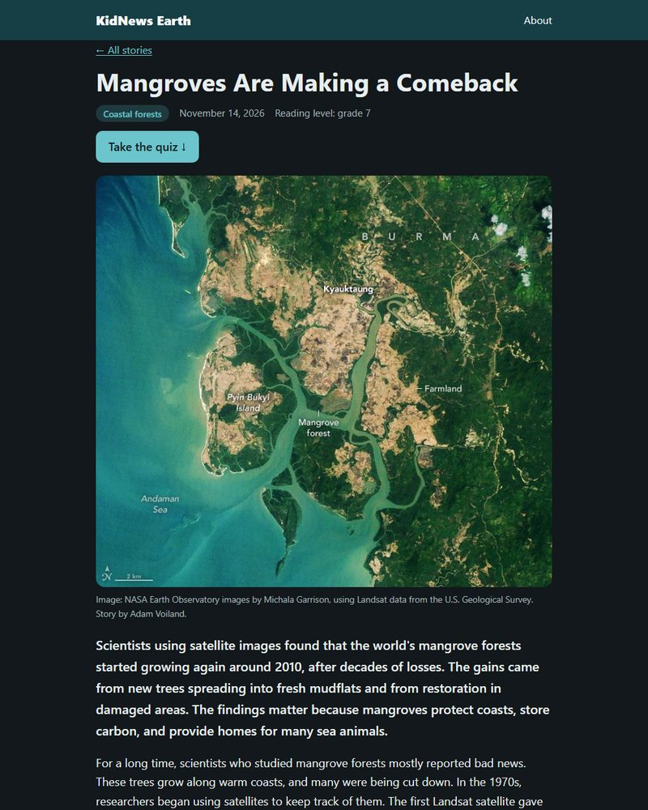
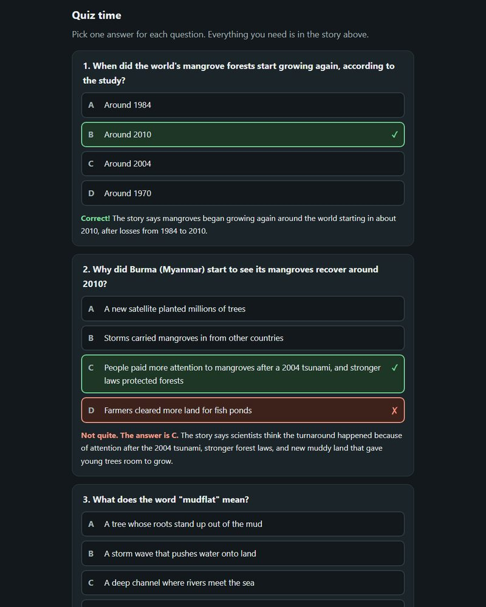
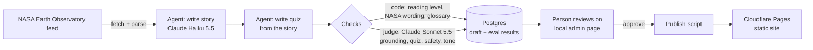

# KidNews Earth

[](https://github.com/zeusydev-lang/kidnews-pipeline/actions/workflows/ci.yml)

**One Earth science story a day for middle-schoolers, written by AI from a NASA
Earth Observatory article, checked by an AI judge, and approved by a person
before it goes live.**

Live site: **https://kidnews-earth.pages.dev**

<p>
  
  
</p>

## The problem

NASA Earth Observatory publishes a great satellite-image story every day, but
it's written for adults. Turning it into something a 12-year-old can read takes
time, and doing it with AI raises real questions for a site aimed at children:
Is every fact actually in the source? Are the quiz answers right? Does the
wording wrongly suggest NASA wrote or approved it? Is anything collected about
the reader?

This project answers those questions in code, measures the answers, and keeps
a person in charge of what gets published.

## How it works



Every day at 12:00 UTC, GitHub Actions:

1. **Publishes** the stories approved since the last run and deploys the site.
2. **Drafts** the newest article: fetch, write the story, write the quiz, run
   seven checks, and save it all as a draft. An unsafe verdict means nothing is
   saved.

Approving happens on a small admin page that only runs on the reviewer's
laptop. Nothing is published without that click.

## Results

| | |
|---|---|
| Cost per story | about **$0.027** (writer ~$0.002, judge ~$0.025), capped at $0.25 per run |
| Checks per story | **7**: reading level, NASA attribution, glossary, grounding, quiz answerability, safety, tone |
| Tests | **275** (unit, database permissions, end-to-end against a fake Claude server) |
| Personal data collected | **none** by design: no accounts, cookies, trackers, analytics or third-party requests |

**Choosing the judge model by measuring it.** Both candidates judged three
drafts that had already been reviewed by hand:

| Judge | Agrees with reviewer | Found the real problem | Cost per story |
|---|---|---|---|
| Claude Haiku 5.5 | 3/3 | 1/2 | $0.0014 |
| **Claude Sonnet 5.5** | 2/3 | **2/2** | $0.033 |

Haiku matched every approve/reject decision, but for the wrong reason on two of
them: it missed that a draft claimed scientists *think* El Niño caused a storm,
when the article only said El Niño is *often associated* with such weather.
Scored on agreement alone, the weaker judge would have won.

**Improving the prompt by measuring it.** Same five articles, prompt v3 vs v4
(`scripts/prompt_eval.py`):

| | v3 | v4 |
|---|---|---|
| Unsupported claims (total) | 7 | **3** |
| Glossary words actually used in the story | 3/5 | **5/5** |
| Reading level, attribution, quiz, safety, tone | 5/5 | 5/5 |

v4 removed made-up "scientists use these images to learn…" filler, numbers the
model worked out itself (it wrote "three weeks earlier" for dates seven weeks
apart), and facts credited to the wrong source.

## Key decisions

| Decision | Why |
|---|---|
| **A person approves every story** | AI output for children needs a human gate. The database itself enforces draft → approved → published, so no code path can skip it. |
| **Separate database logins per job** | The agent can only insert drafts; the admin login can only change status; the publish login can only read a public-fields view. GitHub never holds the owner or admin login. |
| **Structured output through a forced tool call + Pydantic** | The model fills a `final_answer` tool whose arguments are a Pydantic model, so every field is validated, with one automatic retry showing the errors. |
| **The model never writes source details** | Source URL, credit line, slug and reading level come from code. The model can't invent a citation. |
| **Code places the quiz answers** | The model writes the right answer and three wrong ones as text; code shuffles them and records the index. (In v1 the model marked wrong answers as correct.) |
| **Fetched text is untrusted** | The article goes in inside `<article>` tags with instructions to ignore anything inside; the model has no tools that touch secrets or the database. |
| **A separate, stronger judge model** | Checking is a different job from writing. The judge's verdicts are stored per story, so pass rates and reviewer agreement can be tracked over time. |
| **Static site, images copied locally** | No server to attack, no visitor data, and visitors' browsers never contact third-party servers. |
| **litellm for model calls** | Switching provider or model is one setting; per-model differences (thinking, forced tool calls) are handled in one place. |
| **A fake Claude server for tests** | Tests check the exact request Claude would receive, offline and at no cost. |

## What went wrong, and what changed

- **Wrong quiz answers marked as correct** (prompt v1, caught in review):
  answer placement moved from the model to code.
- **A story overstated a cause** (El Niño, caught in review): led to the
  grounding judge, which now catches this automatically.
- **Copyrighted images could slip through** (caught by a test): a credit like
  "Photograph © …" wasn't recognised as a credit line. Any third-party credit
  now drops the image.
- **NASA moved Earth Observatory** to science.nasa.gov in December 2025, and
  its new feed has a small XML error; the fetcher repairs it before parsing.
- **CI's first run failed**: the admin page crashed on import without a
  database configured, which never showed locally. Fixed, and CI now runs
  without any secrets.

## What this project demonstrates

Applied LLM engineering: structured output, prompt versioning, treating model
input and output as untrusted, LLM-as-judge evaluation with measured model
selection, cost tracking with a spending cap, and human-in-the-loop review.
Plus Postgres security (least-privilege roles, a status trigger, a
public-fields view), Python testing, CI/CD on GitHub Actions and deployment to
Cloudflare Pages.

It does not involve model training.

## Tech stack

Python 3.13 · Pydantic · litellm · Claude Haiku 5.5 (writer) and Sonnet 5.5
(judge) · Neon Postgres + psycopg · FastAPI + Jinja (local admin page) ·
pytest · Ruff · GitHub Actions · Cloudflare Pages · plain HTML, CSS and
JavaScript

## Repository layout

```text
agent/        fetch NASA articles, prompts, LLM layer, structured output, judge, daily run
core/         business layer: settings, connections, validation, story functions, checks
admin/        local review page (127.0.0.1 only)
publish/      build the static site from approved stories and deploy it
web/          the public site (no build step)
migrations/   SQL schema, database logins and permissions
scripts/      eval tools (judge_eval, prompt_eval, eval_report), sample data, live smoke test
evals/        fixed article set and saved prompt-eval results
tests/        275 tests
```

## Running it

Setup, database branches, logins, deploying, automation and evals are in the
**[operations guide](docs/OPERATIONS.md)**.

## What I'd do next

- Watch the daily eval results for a few weeks and report real pass rates and
  judge-reviewer agreement.
- Grow the fixed article set beyond five, and run each prompt version more
  than once to separate real changes from noise.
- Teach the writer to leave out correct-but-unsourced background knowledge,
  the main remaining grounding flag.
- More sources and reading levels, once the single-source pipeline has proven
  itself.

## Credits

Built by Vijay Kauvangal. Built with Claude Code as a pair-programming partner.

Stories are based on articles from
[NASA Earth Observatory](https://science.nasa.gov/earth/earth-observatory/).
NASA did not write, review or endorse them.
